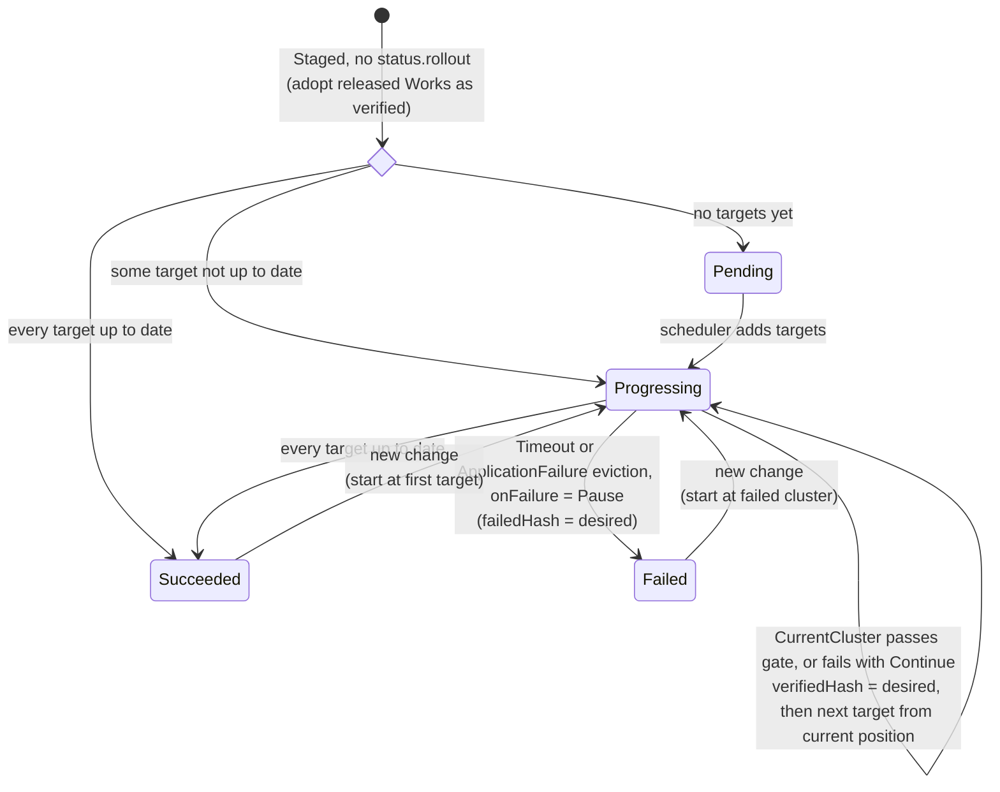

# Staged propagation for PropagationPolicy and ClusterPropagationPolicy

## Summary

Karmada already has per-cluster dispatch suspension
(`spec.suspension.dispatchingOnClusters`) and per-cluster health
(`ResourceBinding.status.aggregatedStatus[].health`), but nothing that
combines them into an ordered rollout. Users roll out "cluster A,
verify, then cluster B" by hand, with no defined failure behavior and
no observable progress.

This proposal adds an opt-in `rolloutStrategy` to `PropagationSpec`.
In `Staged` mode, Karmada releases one cluster at a time in name order;
each cluster must pass a gate (health, conditions, minimum success
time) within a per-cluster timeout before the next is released. Any
change to what a cluster would receive (template, OverridePolicy, or
ConfigMap/Secret data) is staged, tracked by a hash of each cluster's
rendered manifest. The logic is a `pkg/rollout/` library called from
the existing binding controllers: no new controller, no data-plane
change.

## Motivation

All-at-once propagation is the right default but unsafe for:

- **Restart-sensitive stateful services**, e.g. a Trino coordinator
  (single coordinator, ~30s unavailable per restart). Restarting every
  cluster at once takes the service offline.
- **Blast-radius-sensitive cluster infrastructure**: ingress
  controllers, admission webhooks, CoreDNS overrides (typically
  `ClusterPropagationPolicy`).
- **Tenant-driven validation**: smoke tests or custom readiness
  signals between clusters, beyond `Health == Healthy`.

The [dispatch-suspension proposal](../dispatch-suspension/README.md)
(Story 2) describes ordered rollout as a manual pattern and lists
automating it as a Non-Goal. This proposal takes up that Non-Goal.

### Goals

- Ordered, one-cluster-at-a-time rollout across the clusters selected
  by a single PP or CPP.
- Stage every change to a cluster's rendered manifest, not only
  changes that bump the template's `metadata.generation`.
- A per-cluster gate (`RequireHealthy`, `RequiredConditions`,
  `MinSuccessTime`), a per-cluster `Timeout`, and a declared failure
  policy (`Pause | Continue`).
- Reuse existing primitives (`Work.spec.suspendDispatching`,
  `AggregatedStatusItem`); add control logic and status fields only.
- Opt-in per policy, behind alpha feature gate `StagedPropagation`;
  same support for PP and CPP.

### Non-Goals

- Traffic-shifting canary / blue-green (Argo Rollouts, Flagger, mesh).
- Per-replica progressive rollout within a cluster (`rollingUpdate`).
- A general workflow engine (DAGs, per-step scripts).
- Automatic rollback. v1 stops the rollout; reverting the template is
  a GitOps concern.
- Coordination across policies or across bindings.
- Grouping, batching, or user-specified order (possible v2).
- Combining `Staged` with application failover in v1 (see Reschedule
  and failover). Cluster failover is supported.

## Proposal

Setting `rolloutStrategy.type: Staged` on a PP/CPP makes the binding
controller release clusters one at a time by setting
`suspendDispatching` on each cluster's Work, recording progress in the
`ResourceBinding` / `ClusterResourceBinding` status. Scheduling,
overrides, execution, and status aggregation are unchanged.

### User Stories

#### Story 1: Sequential cluster-by-cluster rollout with health gating

As a service owner running the same HA workload in several clusters, I
want a change to roll out one cluster at a time, holding each until it
has been healthy for a minimum period, so the other clusters keep
serving while one restarts.

```yaml
kind: PropagationPolicy
spec:
  # ... resourceSelectors, placement (selects member-east, member-west) ...
  rolloutStrategy:
    type: Staged
    staged:
      gate: {requireHealthy: true, minSuccessTime: 60s}
      timeout: 30m           # per cluster
      onFailure: {action: Pause}
```

`member-east` is updated first and must stay Healthy for 60s before
`member-west` is released.

#### Story 2: Tenant-driven validation between clusters

Karmada's per-cluster `Healthy` means the workload's pods are up; it
does not prove the new version works. As a service owner, I run my own
smoke-test controller in each cluster that writes
`SmokeTestsPassed=True` onto the workload's `.status.conditions[]`. I
want each cluster held until it is Healthy *and* that condition is
`True`.

```yaml
staged:
  gate:
    requireHealthy: true
    requiredConditions:
      - {type: SmokeTestsPassed, status: "True"}
  timeout: 1h
```

This requires the resource interpreter to preserve conditions (see
Interpreter contract for `RequiredConditions`).

#### Story 3: Automatic pause on failure

If a cluster fails its gate, I want the rollout to pause so the
remaining clusters stay on the previous version until I intervene. My
template is in git, so Karmada does not need to roll back.

### Notes/Constraints/Caveats

- **Scope.** Only resources selected by a `Staged` policy are staged,
  each binding independently. Replica counts are excluded, so scaling,
  rebalancing, and failover replica moves reach released clusters
  immediately; a suspended cluster gets them when released.
- **Dependent resources are not coordinated.** A ConfigMap in a
  `Staged` policy gets its own rollout, gated on the ConfigMap's own
  (always Healthy) status, not on the pods that mount it. To gate a
  config change on workload health, reference it from the pod template
  (e.g. a checksum annotation).
- **Enable `Staged` as its own step.** If a policy change to `Staged`
  and a template change land together, the detector handles them
  independently, and the template change may go out all at once first.
- **The gate is checked once per change.** A cluster that becomes
  Unhealthy after passing is a monitoring or failover concern.
- **Suspension is a union.** User suspension (`spec.suspension`) and
  rollout suspension combine; rollout progress never releases a
  user-suspended cluster. Overlap emits a warning, not a rejection.
- **Binding API version.** The policy field is in `policy/v1alpha1`.
  On bindings, the copied `spec.rolloutStrategy` and `status.rollout`
  exist only in `work/v1alpha2` (the storage version), like
  `spec.suspension`; writing a binding through `work/v1alpha1` drops
  them.

### Risks and Mitigations

| Risk | Mitigation |
| --- | --- |
| Gate reads status left over from the previous version | Gate evaluates only fresh status (Status freshness). |
| Rollout steps churn the scheduler and other controllers | Rollout writes only `status.rollout`, which doesn't bump generation. |
| Controller restart or lost status mid-rollout | Desired hashes are recomputed; state is in status; losing it re-verifies every cluster, never releases one. |
| Unreachable cluster stalls the rollout | Its status is not fresh; `Timeout` bounds the wait; `Pause` protects later clusters. |
| `Healthy` is a weak signal | `RequiredConditions`. Karmada observes conditions; it does not run tests. |
| A Karmada upgrade changes how manifests render, changing every hash | Karmada metadata is excluded from the hash; a residual change causes a staged (not all-at-once) rollout. |

## Design Details

The PP/CPP declares the rollout (`spec.rolloutStrategy`); each binding
records progress in `status.rollout`. Which clusters are held is
derived on every reconcile, never stored. `ClusterResourceBinding`
embeds the same spec and status types, so everything below applies to
CRB unchanged.

### API changes

**Policy** (`PropagationSpec`, shared by PP and CPP):

```go
type PropagationSpec struct {
    // ... existing fields ...
    RolloutStrategy *RolloutStrategy `json:"rolloutStrategy,omitempty"`
}

type RolloutStrategy struct {
    // +kubebuilder:validation:Enum=AllAtOnce;Staged
    // +kubebuilder:default=AllAtOnce
    Type   RolloutStrategyType `json:"type"`
    Staged *StagedRollout      `json:"staged,omitempty"` // required when Type=Staged
}

type StagedRollout struct {
    Gate      *RolloutGate          `json:"gate,omitempty"`      // default {}
    Timeout   *metav1.Duration      `json:"timeout,omitempty"`   // per cluster; default 30m
    OnFailure *RolloutFailurePolicy `json:"onFailure,omitempty"` // default {action: Pause}
}

type RolloutGate struct {
    RequireHealthy     *bool                  `json:"requireHealthy,omitempty"` // default true
    RequiredConditions []ConditionRequirement `json:"requiredConditions,omitempty"`
    MinSuccessTime     *metav1.Duration       `json:"minSuccessTime,omitempty"` // default 0
}

// Matches a condition in the workload's status.conditions[];
// a missing condition counts as Unknown.
type ConditionRequirement struct {
    Type string `json:"type"`
    // +kubebuilder:validation:Enum=True;False;Unknown
    // +kubebuilder:default=True
    Status metav1.ConditionStatus `json:"status,omitempty"`
}

type RolloutFailurePolicy struct {
    // +kubebuilder:validation:Enum=Pause;Continue
    // +kubebuilder:default=Pause
    Action RolloutFailureAction `json:"action"`
}

type RolloutStrategyType string  // "AllAtOnce" (existing behavior) | "Staged"
type RolloutFailureAction string // "Pause" | "Continue"
type RolloutPhase string         // "Pending" | "Progressing" | "Succeeded" | "Failed"
type ClusterRolloutState string  // "Verified" | "Gating" | "Suspended" | "Failed"
```

A cluster passes the gate when its status is fresh, `RequireHealthy`
holds (if set), and every `RequiredConditions` entry matches, all
continuously for `MinSuccessTime`. Only condition `type` and `status`
are compared, so heartbeats don't reset the clock. `Timeout` starts
when a cluster becomes current; worst case is `N × Timeout`.

**Binding spec.** `ResourceBindingSpec` gains `RolloutStrategy`, which
the detector copies from the policy like `Failover` and
`ConflictResolution`. The binding controller never writes the
binding's spec.

**Binding status.**

```go
type ResourceBindingStatus struct {
    // ... existing fields ...
    Rollout *RolloutStatus `json:"rollout,omitempty"`
}

type RolloutStatus struct {
    // +kubebuilder:validation:Enum=Pending;Progressing;Succeeded;Failed
    Phase RolloutPhase `json:"phase"`
    // CurrentCluster is the cluster being gated; when Failed, the one that failed.
    CurrentCluster string `json:"currentCluster,omitempty"`
    // +listType=map
    // +listMapKey=name
    Clusters []ClusterRolloutStatus `json:"clusters,omitempty"`

    // Persisted so MinSuccessTime and Timeout survive restarts.
    GateSatisfiedSince      *metav1.Time `json:"gateSatisfiedSince,omitempty"`
    CurrentClusterStartedAt *metav1.Time `json:"currentClusterStartedAt,omitempty"`
    StartedAt               *metav1.Time `json:"startedAt,omitempty"`
    CompletedAt             *metav1.Time `json:"completedAt,omitempty"`
    Conditions              []metav1.Condition `json:"conditions,omitempty"`
    Message                 string             `json:"message,omitempty"`
}

type ClusterRolloutStatus struct {
    Name string `json:"name"`
    // Display only: Verified | Gating | Suspended | Failed.
    State ClusterRolloutState `json:"state,omitempty"`
    // Last rendered hash; used to detect a new change while Failed.
    DesiredHash string `json:"desiredHash,omitempty"`
    // Last hash that passed the gate (or was forced past by Continue).
    VerifiedHash string `json:"verifiedHash,omitempty"`
    // Hash that failed the gate under Pause; cleared when the cluster passes.
    FailedHash string `json:"failedHash,omitempty"`
}
```

Phases: `Pending` (no targets yet), `Progressing`, `Succeeded` (every
cluster up to date), `Failed` (a cluster failed under `Pause`). A
cluster is **up to date** when its desired hash equals its
`VerifiedHash`.

### Manifest hash

The template's `metadata.generation` misses OverridePolicy edits
(Works are re-rendered without a template change) and kinds with no
generation (ConfigMap, Secret). The rollout is therefore keyed on a
hash of each cluster's rendered manifest.

`rollout.ManifestHash` is a single function, applied identically to a
freshly rendered manifest (after `ReviseReplica`, Job completions, and
`ApplyOverridePolicies`) and, during adoption, to a manifest stored in
a Work. It:

1. applies the same pruning `CreateOrUpdateWork` does
   (`prune.RemoveIrrelevantFields`: `status`, `resourceVersion`, `uid`,
   ...). Without this, every status update Karmada writes back to the
   template would change the hash;
2. zeroes the fields Karmada sets per cluster from the scheduling
   result: the replica field via `ReviseReplica(copy, 0)`, and
   `spec.completions` for Jobs (set by `applyJobCompletions`);
3. drops Karmada-managed metadata (`util.ManagedResourceLabels`,
   `util.ManagedResourceAnnotations`, the hash annotation itself);
4. returns a version-prefixed SHA-256 of the JSON, e.g. `v1:9c2e…`.
   Changing the algorithm requires a new prefix.

Each cluster has three values:

| Value | Meaning | Where it lives |
| --- | --- | --- |
| desired | what the cluster should run | recomputed every reconcile; written as annotation `work.karmada.io/manifest-hash` in the Work's manifest |
| reported | what the cluster runs | read from that annotation on the member object (see Status freshness) |
| verified | last hash that passed the gate | `status.rollout.clusters[].verifiedHash` |

Desired needs no storage: it is a deterministic function of the
template, OverridePolicies, and binding spec. Reported is the
annotation value read back from the member, not a hash recomputed
there, so desired and reported always come from the same function.
The annotation is added
only for `Staged` bindings and is listed in
`util.ManagedResourceAnnotations`, so it is stripped when a resource
stops being managed.

### Status freshness

`Health` and conditions carry no revision, so right after a change
they still describe the old manifest. When reflecting status, the
work-status controller also records, from the same member-object
snapshot:

```go
// Added to workv1alpha1.ManifestStatus and workv1alpha2.AggregatedStatusItem.
ManifestHash             string `json:"manifestHash,omitempty"`             // work.karmada.io/manifest-hash
MemberGeneration         int64  `json:"memberGeneration,omitempty"`         // metadata.generation
MemberObservedGeneration *int64 `json:"memberObservedGeneration,omitempty"` // status.observedGeneration
```

These are read from object metadata, not through the interpreter
(only four native reflectors report generations). `assembleWorkStatus`
(`pkg/util/helper/workstatus.go`), which today copies only `Status`
and `Health` from the Work into `AggregatedStatusItem`, also copies
the three new fields; otherwise `Compute` would always see an empty
hash. A cluster is fresh when:

- `ManifestHash == desired` (the new manifest reached the member), and
- `MemberObservedGeneration >= MemberGeneration` (the member's
  controller processed it). Skipped when `MemberObservedGeneration` is
  unset or `MemberGeneration` is 0 (kinds that don't track generation).

An empty hash is never fresh. The gate and its `MinSuccessTime` clock
start only once a cluster is fresh. A `RequiredConditions` entry
whose matching condition carries `observedGeneration` (as
`metav1.Condition` does) matches only if it is `>= MemberGeneration`.

A matching hash proves the new manifest was written, not that the
object's controller has reacted. If the object is processed by a
controller (`MemberGeneration > 0`) but reports no sign of having
processed the new spec (no `status.observedGeneration`, and no
matching required condition carrying `observedGeneration`), the gate
waits at least 30s, or half of `timeout` if that is shorter
(`max(minSuccessTime, min(30s, timeout/2))`), so status left over from
the previous version can't pass immediately and the floor never makes
the gate unpassable. Otherwise `minSuccessTime` applies as written.
Kinds that don't track generation (ConfigMap, Secret) have no
controller and no status to go stale.

### Interpreter contract for `RequiredConditions`

`RequiredConditions` reads `.status.conditions[]` from
`AggregatedStatusItem.Status`. Native reflectors keep conditions for
`Job` and for kinds using `reflectWholeStatus` (most CRDs), but drop
them for `Deployment`, `DaemonSet`, `StatefulSet`, and `ReplicaSet`: their
`Wrapped*Status` types embed the full Kubernetes status, but the
`reflect*Status` functions copy only replica fields. Fix: also copy
`Conditions`, stripping Deployment's `LastUpdateTime` (it changes on
every progress update) to avoid `Work.Status` churn. Aggregators don't
read them, so federated status is unchanged. Custom interpreters must
preserve `Conditions`; otherwise the cluster fails with
`Reason=ConditionsMissing` after `Timeout`.

### Rollout reconciliation

For `Staged` bindings, `ensureWork` is split into render and write,
with the rollout decision between them:

```text
syncBinding
 ├─ 1. render: per target cluster → manifest, desired[cluster] = ManifestHash(manifest)
 ├─ 2. Compute(strategy, prevStatus, aggregatedStatus, desired, now)
 │       -> (suspendedClusters, newStatus, requeueAfter)
 │     write status.rollout
 └─ 3. CreateOrUpdateWork(manifest, suspendDispatching) per cluster
```

- **Targets** are `mergeTargetClusters(spec.Clusters, spec.RequiredBy)`,
  the set `ensureWork` already dispatches to, sorted by name.
- **Suspended set**: every target that is not up to date, except
  `CurrentCluster`; empty when `Succeeded`. It is passed in memory to
  `shouldSuspendDispatching`, which unions it with `spec.suspension`.
  Each cluster's `state` mirrors it.
- **Passing the gate** sets `VerifiedHash = desired` and clears
  `FailedHash`.
- **No leak.** `Compute` sees a new hash before the Work carrying it is
  written, so a change to a released cluster is suspended in the same
  Work update that delivers it.
- **Status only.** Rollout steps never bump the binding's generation,
  so the scheduler, dependencies distributor, and graceful eviction
  controller don't react. `status.rollout` is persisted before any Work
  it releases, so a crash in between can't release a cluster without
  its predecessor's `VerifiedHash` on record.
- **Trigger.** Both binding controllers filter events with
  `GenerationChangedPredicate`, so status changes never reach them
  today. The RB/CRB watch becomes `Or(GenerationChanged,
  aggregatedStatusChanged)`, the latter only for `Staged` bindings and
  ignoring `status.rollout`. Timers use `requeueAfter`.



**Entering Staged mode (adoption).** Staging applies to changes made
after it is enabled. When `status.rollout` is absent, every target
whose Work exists and is not suspended is adopted with
`VerifiedHash = ManifestHash(the Work's current manifest)`. So enabling
`Staged` on a deployed workload goes straight to `Succeeded`, and the
hash annotation is added in the same Work write (top-level metadata;
no pod restart). Targets with no Work (a new workload or cluster) or a
user-suspended Work are not adopted and are gated normally. Adoption
reads the Work because member objects carry no hash annotation yet;
whatever is in a released Work was dispatched already.

**Leaving Staged mode.** When the strategy is unset or `AllAtOnce`, or
the feature gate is disabled, `Compute` isn't called, nothing is
suspended, and `status.rollout` is cleared so a later re-entry adopts
afresh.

### Rollout order

`CurrentCluster` is the first target that is not up to date, searching
by name from the current position (the previous `currentCluster`) and
wrapping around. With no rollout in progress, the search starts at the
first target.

- **Change after `Succeeded`**: starts at the first target.
- **Change mid-rollout**: `CurrentCluster` keeps its slot (its gate
  restarts), then the rollout continues and wraps around to clusters
  that passed the old hash. Restarting from the first target would
  starve the tail when changes arrive faster than a full rollout.
- **Change after `Failed`**: the position is the failed cluster, so the
  fix is gated there first instead of the cluster being held on a
  known-bad version.

If changes arrive faster than a single cluster's gate, nothing can be
verified under any order; batch changes or shorten `MinSuccessTime`.

### Reschedule and failover

`Compute` re-reads the target list every reconcile.

- **Cluster added** (placement change or failover replacement): not up
  to date; released when the rollout reaches it.
- **Cluster removed** (placement change or taint-based cluster
  failover): its entry is dropped. If it was `CurrentCluster`, the
  rollout moves on; the next cluster is still gated. Removing the
  failed cluster does not leave `Failed`.
- **All clusters removed**: back to `Pending`.

An evicted cluster is no longer a target, so it never receives a newer
manifest; its Work is kept or deleted per `PurgeMode` as today.

**Application failover is rejected with `Staged` in v1.** It evicts on
the same health signal the gate uses, so a bad version on
`CurrentCluster` would look like a removal, and the rollout would carry
it to the next cluster and to each replacement. The webhook rejects
the combination. As a safety net, an `ApplicationFailure` eviction of
`CurrentCluster` (`spec.gracefulEvictionTasks`) counts as a gate
failure. Cluster failover can't be excluded this way, since it is
triggered by cluster taints rather than a policy opt-in. A workload
that prefers no failover can tolerate the `cluster.karmada.io/not-ready`
and `cluster.karmada.io/unreachable` `NoExecute` taints in
`placement.clusterTolerations` (without `tolerationSeconds`); a failed
cluster then stays a target, and `Timeout` and `Pause` handle it as a
stalled cluster.

**Known limitation.** A failover replacement has nothing running, so
holding it means no workload. Mid-rollout, a replacement runs nothing
until the rollout reaches it (or, under `Failed`, until the user
recovers). Outside a rollout it is released immediately.

### Failure handling

- **Pause** (default): `Phase=Failed`, `FailedHash = desired`,
  `VerifiedHash` unchanged; clusters that are not up to date stay
  suspended. The rollout stays `Failed`, without re-gating, until a new
  change arrives: a target with an entry renders a hash different from
  its recorded `DesiredHash`. Evictions and replacements don't resume
  it. To recover, push a fix (gated on the failed cluster first) or
  remove `rolloutStrategy`. To retry the same version, make a no-op
  template change (e.g. an annotation).
- **Continue**: `VerifiedHash = desired` despite the failure; emit a
  `Warning` event and move on.

### Feature gate, validation, and defaulting

- Feature gate `StagedPropagation` (alpha). When disabled, the webhook
  rejects `type: Staged`.
- `type: Staged` requires `staged`; `type: AllAtOnce` must not set
  `staged`, so gate, timeout, and failure settings are never silently
  ignored.
- Durations: `timeout > 0`, `minSuccessTime >= 0`, and
  `minSuccessTime < timeout` (using defaults for unset values), so a
  healthy cluster can always pass the gate before it times out.
- The webhook rejects `Staged` together with `failover.application`,
  alongside the existing rule that `failover.application` requires
  `propagateDeps`.
- Defaults: `Type=AllAtOnce`, `Timeout=30m`, `OnFailure.Action=Pause`,
  `Gate.RequireHealthy=true`, `Gate.MinSuccessTime=0`; omitted `gate`
  means `{}`.

### Test Plan

**Unit** (`pkg/rollout`, webhook, detector, work-status controller):

- Validation and defaults: `Staged` without `staged` and `AllAtOnce`
  with `staged` are rejected; zero/negative `timeout`, negative
  `minSuccessTime`, and `minSuccessTime >= timeout` (including against
  the default `timeout`) are rejected; `Staged` +
  `failover.application` is rejected on create and update.
- `ManifestHash`: deterministic; changes on template, OverridePolicy,
  and ConfigMap data edits; unchanged by replicas, divided Job
  `completions`, Karmada metadata, and template `status` /
  `resourceVersion`; equal for a rendered manifest and its stored Work
  copy.
- Transitions and order: sort order from `Succeeded`; mid-rollout
  change keeps `CurrentCluster` and wraps; fix after `Failed` starts at
  the failed cluster; an OverridePolicy on one cluster re-gates only
  that cluster.
- Freshness: mismatched or empty hash, or `observedGeneration <
  generation`, neither passes nor starts the clock; skip rules for
  unset values. A condition with an older `observedGeneration` doesn't
  match. A kind with `MemberGeneration > 0` and no generation signal
  waits at least 30s even with `minSuccessTime: 0`; a Deployment and a
  ConfigMap don't. The work-status controller records the three fields,
  and `assembleWorkStatus` carries them from the Work to the binding.
- Failure: `Failed` persists without re-gating; evicting the failed
  cluster or adding a replacement doesn't resume it; a new hash does.
  `Continue` sets `VerifiedHash`.
- Adoption: a deployed workload enters `Succeeded`; targets with no
  Work or a suspended Work are gated.
- Failover: taint eviction of `CurrentCluster` moves on;
  `ApplicationFailure` eviction counts as a gate failure.
- Reconcile: rollout writes only status (generation unchanged across a
  rollout); the predicate fires on `aggregatedStatus` only; restarts
  and crashes between writes never release an unverified cluster.
- Reflectors keep `Conditions` for the four replica-based kinds.

**Integration & E2E:**

- N-cluster rollout toggles `suspendDispatching` in order; `Pause`
  holds later clusters.
- Condition-driven promotion (`Available`, `SmokeTestsPassed`).
- After `Succeeded`, an OverridePolicy edit and a ConfigMap change each
  roll out in order.
- CPP with namespaced and cluster-scoped targets; Argo CD / Flux sync
  of the PP doesn't fight the rollout.

## Alternatives

- **Suspension on PP / CPP spec.** Rejected: GitOps drift, detector
  fan-out on every step, collision with user suspension.
- **Storing held clusters in RB / CRB spec** (an earlier
  `spec.suspension.rollout`). Rejected: it duplicates `status.rollout`,
  and every write bumps generation and wakes the scheduler.
- **Dedicated rollout controller.** Rejected for v1: it would need a
  stored hand-off to the binding controller. `pkg/rollout/` is a pure
  library, so extracting one later is possible.

## Future work

- **Application failover with `Staged`**: how health-driven evictions
  count toward the gate, and what a replacement runs mid-rollout.
- **Early release of replacements** whose hash already passed on
  another cluster, to close the capacity gap.
- **Explicit retry** of the same hash without a no-op template change.
